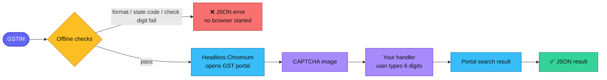
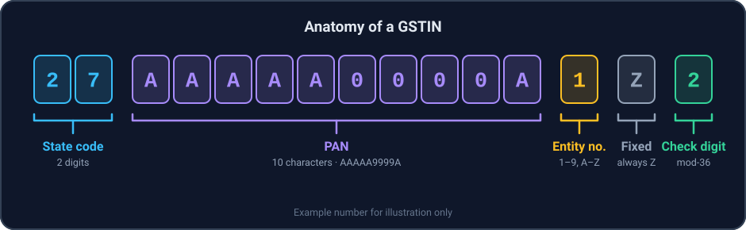

<div align="center">


<br>


<a href="https://github.com/git-hdsoftsolutions/hdsoft-gst-validator/commits"></a>

<br><br>

**[Features](#-features)** · **[How it works](#-how-it-works)** · **[Install](#-installation)** · **[Quick start](#-quick-start)** · **[Portal lookup](#-portal-lookup)** · **[GSTIN anatomy](#-gstin-anatomy)** · **[Build](#-build-and-test)** · **[Developer](#-developer)**

</div>

<br>

A production-ready **Java 8** library for **Indian GSTIN** numbers. Catch mistyped numbers instantly and offline,
then optionally confirm a GSTIN against the official GST portal and get the taxpayer's registration details back as JSON.

## ✨ Features

| | |
|---|---|
| ⚡ **Instant offline checks** | Layout, state code and the modulo-36 check digit are verified instantly, with no network and no browser. |
| 🧩 **Rich result object** | Get the normalised GSTIN, state code and name, embedded PAN, entity number and check digit, or a precise failure reason. |
| 🌐 **GST portal lookup** | Fetch legal name, trade name, status, offices, business activities and HSN goods and services as clean JSON. |
| 🛡️ **Fails fast** | Typos are rejected before a browser starts or a CAPTCHA is shown. |
| ☕ **Java 8 only** | Compiled for Java 1.8, and the build fails if any newer API is used. |
| 🧪 **Tested** | JUnit tests cover the checksum (including every single-character substitution in the first 14 characters), state codes, normalisation and locale safety. |

## 🧭 How it works

`GSTINValidator` always runs the offline checks first. Only a well-formed GSTIN ever reaches the portal.



| Level | Class | Needs network and browser | What it proves |
|:------|:------|:-------------------------:|:---------------|
| 🟢 **Offline** | `GSTINOfflineValidator` | ❌ No | The number is **well formed**: correct layout, known state code, correct check digit. |
| 🔵 **Portal lookup** | `GSTINValidator` | ✅ Yes (headless Chromium) | The GSTIN **exists on the GST portal**, with its registration details. |

## 📋 Requirements

- ☕ **Java 8**. The library targets, and is restricted to, the Java 1.8 language level and API.
- 📦 **Maven 3.6.3+** to build.
- 🌐 For portal lookups only: network access to `services.gst.gov.in`. Playwright downloads a Chromium build the first time
  it runs, and on Linux the usual Chromium system libraries must be present.

> [!NOTE]
> The offline validator uses plain Java and does not start Playwright, so it works anywhere Java 8 runs.

## 📦 Installation

The library is not published to a public repository yet. Build it and install it into your local Maven repository:

```bash
git clone https://github.com/git-hdsoftsolutions/hdsoft-gst-validator.git
cd hdsoft-gst-validator
mvn clean install
```

Then add it to your project:

```xml
<dependency>
    <groupId>com.hdsoft.gst</groupId>
    <artifactId>gstin-validator</artifactId>
    <version>1.0.0</version>
</dependency>
```

## 🚀 Quick start

### Offline validation

```java
import com.hdsoft.gst.GSTINCheckResult;
import com.hdsoft.gst.GSTINOfflineValidator;

public class OfflineExample {
    public static void main(String[] args) {
        // Simple yes / no
        boolean ok = GSTINOfflineValidator.isValid("27AAAAA0000A1Z2");   // true

        // Full detail
        GSTINCheckResult result = GSTINOfflineValidator.check(" 27aaaaa0000a1z2 ");
        if (result.isValid()) {
            System.out.println(result.getGstin());       // 27AAAAA0000A1Z2  (trimmed, upper-cased)
            System.out.println(result.getStateCode());   // 27
            System.out.println(result.getStateName());   // Maharashtra
            System.out.println(result.getPan());         // AAAAA0000A
        } else {
            System.out.println(result.getError());       // e.g. INVALID_CHECK_DIGIT
            System.out.println(result.getMessage());     // e.g. Invalid GSTIN check digit.
        }
    }
}
```

`check` never throws and never returns `null`. Input is trimmed and upper-cased with `Locale.ROOT`, so the result
does not depend on the JVM's default locale.

### Failure reasons

| | `GSTINCheckResult.Error` | Message | Meaning |
|:-:|:--|:--|:--|
| 🕳️ | `EMPTY` | `GSTIN cannot be empty.` | `null` or blank input. |
| 🔤 | `INVALID_FORMAT` | `Invalid GSTIN format.` | Not 15 characters in the standard layout. |
| 🗺️ | `INVALID_STATE_CODE` | `Invalid GSTIN state code.` | The first two digits are not a GST state or jurisdiction code. |
| 🔢 | `INVALID_CHECK_DIGIT` | `Invalid GSTIN check digit.` | The 15th character does not match the checksum of the first 14. |

Components are filled in as far as the check got. A result that failed on the check digit still exposes the state and
PAN, while one that failed on the format exposes none of them.

### Helpers

```java
char check  = GSTINOfflineValidator.computeCheckDigit("27AAAAA0000A1Z");  // '2'
String name = GSTINOfflineValidator.getStateName("29");                    // Karnataka
```

## 🔎 Portal lookup

`GSTINValidator` opens the GST portal's *Search Taxpayer* page in headless Chromium, enters the GSTIN, and **passes
the portal's CAPTCHA image to a handler you provide**. The handler shows the image to a person and returns the six
digits they type. The library does not solve CAPTCHAs.

<details>
<summary><b>👉 Example: Swing CAPTCHA dialog (works on any Java 8 JDK)</b></summary>

<br>

```java
import com.hdsoft.gst.GSTINValidator;

import javax.swing.*;
import java.awt.*;
import java.lang.reflect.InvocationTargetException;

public class LookupExample {

    public static void main(String[] args) {
        GSTINValidator validator = new GSTINValidator();

        // Called once per lookup, on the calling thread. It must block until the answer is available.
        validator.work((image, answer) -> {
            Runnable ask = () -> {
                JPanel panel = new JPanel(new BorderLayout(10, 10));
                panel.add(new JLabel(new ImageIcon(image)), BorderLayout.CENTER);

                JTextField field = new JTextField(10);
                JPanel input = new JPanel(new FlowLayout(FlowLayout.LEFT));
                input.add(new JLabel("Enter the 6-digit CAPTCHA:"));
                input.add(field);
                panel.add(input, BorderLayout.SOUTH);

                int choice = JOptionPane.showConfirmDialog(
                        null, panel, "GST CAPTCHA", JOptionPane.OK_CANCEL_OPTION, JOptionPane.PLAIN_MESSAGE);
                if (choice == JOptionPane.OK_OPTION) {
                    answer.set(field.getText().trim());   // leave unset to cancel
                }
            };

            try {
                if (SwingUtilities.isEventDispatchThread()) {
                    ask.run();
                } else {
                    SwingUtilities.invokeAndWait(ask);
                }
            } catch (InterruptedException | InvocationTargetException e) {
                throw new RuntimeException(e);   // reported as an error in the JSON result
            }
        });

        String json = validator.validateGSTIN("27AAAAA0000A1Z2");
        System.out.println(json);
    }
}
```

A JavaFX version of the handler is in [`examples/Test.java`](examples/Test.java).

</details>

### 📤 Result

`validateGSTIN` always returns a pretty-printed JSON string and never throws.

<details open>
<summary><b>✅ Success</b></summary>

<br>

```json
{
  "success": true,
  "gstin": "27AAAAA0000A1Z2",
  "legalName": "EXAMPLE TRADERS",
  "tradeName": "EXAMPLE TRADERS",
  "effectiveDate": "01/07/2017",
  "constitutionOfBusiness": "Proprietorship",
  "gstinUinStatus": "Active",
  "taxpayerType": "Regular",
  "administrativeOffice": ["..."],
  "otherOffice": ["..."],
  "principalPlaceOfBusiness": "...",
  "natureOfCoreBusinessActivity": "Retail Business",
  "natureOfBusinessActivities": ["Retail Business", "Wholesale Business"],
  "goodsAndServices": {
    "goods":    [ { "hsn": "...", "description": "..." } ],
    "services": [ { "hsn": "...", "description": "..." } ]
  }
}
```

Values are illustrative. Fields the portal does not show are returned as empty strings or empty arrays.

</details>

<details>
<summary><b>❌ Failure</b></summary>

<br>

```json
{
  "success": false,
  "gstin": "27AAAAA0000A1Z2",
  "error": "CAPTCHA validation failed or CAPTCHA expired."
}
```

`gstin` is omitted when the input was empty. Besides the offline errors above, `error` can be:

| `error` | Cause |
|:--|:--|
| `CAPTCHA handler is not set. Call work(...) before validateGSTIN(...).` | `work(...)` was never called. Returned before any browser starts. |
| `CAPTCHA entry cancelled.` | The handler returned nothing or an empty string. |
| `Invalid CAPTCHA. CAPTCHA must contain exactly 6 digits.` | The handler returned something other than six digits. |
| `CAPTCHA validation failed or CAPTCHA expired.` | The portal rejected the CAPTCHA. |
| `GST portal did not return a search result.` | The portal returned no result within 30 seconds. |
| *(exception message)* | Any other failure, such as no network or a browser start error. |

</details>

### ⚠️ Good to know

> [!IMPORTANT]
> **One request, no retries.** Every call is a fresh lookup with a fresh browser and a fresh CAPTCHA. If it fails
> (for example because of a mistyped CAPTCHA), make a new call.

> [!WARNING]
> **Depends on the portal's page.** Results are read from the portal's HTML. If the portal changes its page structure,
> the lookup may fail or return empty fields until the library is updated.

> [!NOTE]
> - **Slow by nature.** Each lookup starts a browser, so expect several seconds plus the time the user takes to type the CAPTCHA.
> - **Threading.** Register the handler before the first call. Concurrent calls are safe as long as your handler is.
> - **Offline success is not registration.** `GSTINOfflineValidator` only proves the number is well formed.

## 🧬 GSTIN anatomy

<div align="center">
  
</div>

<br>

| Part | Length | Rule |
|:-----|:------:|:-----|
| 🟦 **State code** | 2 | A GST state or jurisdiction code (see below). |
| 🟪 **PAN** | 10 | 5 letters, 4 digits, 1 letter (`AAAAA9999A`). |
| 🟨 **Entity number** | 1 | `1`-`9`, then `A`-`Z`. Counts registrations of the same PAN in the state. |
| ⬜ **Fixed letter** | 1 | Always `Z`. |
| 🟩 **Check digit** | 1 | Modulo-36 checksum of the first 14 characters. |

> [!NOTE]
> **Scope:** the standard 15-character GSTIN. Identifiers issued in other layouts (for example UIN or OIDAR numbers)
> are rejected as `INVALID_FORMAT`.

<details>
<summary><b>🗺️ Accepted state codes</b></summary>

<br>

| Code | State / jurisdiction | Code | State / jurisdiction |
|:----:|:---------------------|:----:|:---------------------|
| 01 | Jammu and Kashmir | 21 | Odisha |
| 02 | Himachal Pradesh | 22 | Chhattisgarh |
| 03 | Punjab | 23 | Madhya Pradesh |
| 04 | Chandigarh | 24 | Gujarat |
| 05 | Uttarakhand | 25 | Daman and Diu (legacy) |
| 06 | Haryana | 26 | Dadra and Nagar Haveli and Daman and Diu |
| 07 | Delhi | 27 | Maharashtra |
| 08 | Rajasthan | 28 | Andhra Pradesh (before 2014 bifurcation) |
| 09 | Uttar Pradesh | 29 | Karnataka |
| 10 | Bihar | 30 | Goa |
| 11 | Sikkim | 31 | Lakshadweep |
| 12 | Arunachal Pradesh | 32 | Kerala |
| 13 | Nagaland | 33 | Tamil Nadu |
| 14 | Manipur | 34 | Puducherry |
| 15 | Mizoram | 35 | Andaman and Nicobar Islands |
| 16 | Tripura | 36 | Telangana |
| 17 | Meghalaya | 37 | Andhra Pradesh |
| 18 | Assam | 38 | Ladakh |
| 19 | West Bengal | 97 | Other Territory |
| 20 | Jharkhand | 99 | Centre Jurisdiction |

The legacy codes `25` and `28` are accepted so that older registrations still pass.

</details>

## 🔧 Build and test

```bash
mvn clean verify
```

This compiles for Java 1.8, runs the unit tests, builds the sources and Javadoc jars, and fails if any API newer than
Java 8 is used. The unit tests need no network and no browser.

<details>
<summary><b>📁 Project layout</b></summary>

<br>

```text
hdsoft-gst-validator
├── pom.xml
├── README.md
├── docs/images/                          banner and diagrams used by this README
├── examples/Test.java                    JavaFX CAPTCHA demo (not built by Maven)
└── src
    ├── main/java/com/hdsoft/gst
    │   ├── GSTINOfflineValidator.java    format, state code and check digit checks
    │   ├── GSTINCheckResult.java         result of an offline check
    │   └── GSTINValidator.java           GST portal lookup, returns JSON
    └── test/java/com/hdsoft/gst
        ├── GSTINOfflineValidatorTest.java
        └── GSTINValidatorTest.java
```

</details>

## 👤 Developer

<div align="center">

### Hdsoft Solutions

<a href="mailto:hdsoftsolutions@yandex.com"></a>
<a href="https://github.com/git-hdsoftsolutions"></a>

<br><br>

<sub>Questions, bug reports and ideas are welcome.</sub>

</div>
